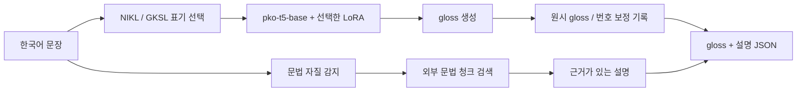

# 한국어 → 한국수어(KSL) Gloss

한국어 문장을 한국수어의 gloss 시퀀스로 변환하는 연구 프로젝트입니다.
국립국어원 2024·2025 말뭉치, 재난안전 자료, GKSL3k의 텍스트 주석을 준비하고,
`paust/pko-t5-base`에 LoRA와 출력층 학습을 적용했습니다.
데이터 전처리, 학습, 추론, 문법 RAG, 다중 정답 평가 코드를 제공합니다.

이 디렉터리는 `llm최종.zip`에서 정리한 **코드 배포본**입니다.
원본/가공 말뭉치, 영상·skeleton, 문법 원문 청크, 모델 가중치는 Git에 포함하지 않습니다.
실험의 집계 수치와 선택 근거는 [reports](reports/), 설정 기록은 [configs](configs/)에 있습니다.

## 프로젝트 범위

입력은 한국어 문장, 출력은 한국수어 표현을 기록한 gloss 시퀀스입니다.
NIKL은 `학교1`, `지시1_1` 같은 번호형 표기, GKSL은 번호 없는 표기를 사용하므로
두 모델 경로를 둡니다. Gloss는 수어의 주석 표현이며 비수지표지·공간 문법을 모두 담지는 못합니다.
영상·MediaPipe skeleton 생성은 후속 단계로, 이 모델의 입력에는 사용하지 않습니다.

## 모델과 구조

| 구성 | 사용 모델/방법 | 역할 |
|---|---|---|
| 최종 기반 모델 | [paust/pko-t5-base](https://huggingface.co/paust/pko-t5-base) | 한국어 seq2seq |
| NIKL 최종 어댑터 | `pko_t5_base_ksl_nikl_2024_adapter_v4` | 번호형 gloss, 기본/2024/2025 공통 경로 |
| GKSL 최종 어댑터 | `pko_t5_base_ksl_v2_gksl_adapter_v1` | 번호 없는 gloss |
| 파인튜닝 | LoRA r=16, alpha=32, dropout=0.05 + `lm_head` 학습 | 출력 분포 적응 |
| LoRA 대상 | `q,k,v,o,wi_0,wi_1,wo` | Attention와 gated FFN |
| 문법 설명 | 문법 자질 + TF-IDF 검색 | 별도 근거 설명 계층 |
| 초기 비교 모델 | KE-T5 small/small-ko 계열 | 반복 출력 실패 실험 |
| 문장 증강 실험 | MiniMax M3 / NVIDIA NIM | API 제한으로 중단, 최종 생성 라벨 0 |

최종 모델은 gloss 전용 토큰을 추가하지 않았으며 source/target 길이는 384/128입니다.
`lm_head`는 전체 학습하므로 일반적인 attention-only LoRA보다 어댑터가 큽니다.



번역은 **no-RAG**입니다. 문법 RAG는 별도 설명 계층이며
`evidence_used_for_translation=false`로 표시합니다. 실험용 lexicon/example/grammar/full
RAG도 구현되어 있지만, 최종 번역 모델의 기본 경로는 no-RAG입니다.

## 파일 구조

```text
llm/
├── core/               # 설정, 데이터 로딩, RAG, 지표, 모델 경로
├── data_processing/    # 원본 추출, 표기 분리, 그룹 균형, 문법 청킹
├── training/           # SFT / LoRA + lm_head 학습
├── inference/          # 추론, 모델 라우팅, 문법 설명
├── evaluation/         # 충돌·다중 정답·bootstrap·디코딩 평가
├── scripts/            # 로컬 ZIP의 선택적 자원 복원
├── tests/              # 원본 안전, 누수, 표기, 경로 회귀 테스트
├── configs/            # 최종 모델의 이식 가능한 설정 기록
├── reports/            # 텍스트/영상 없는 집계 실험 결과
├── docs/               # 데이터, 실행, 실험 기록
├── examples/           # 자체 작성한 스키마 fixture
├── requirements.txt
├── requirements-dev.txt
├── requirements-dense.txt
└── pytest.ini
```

로컬에서만 생성하는 경로는 `base_model/`, `outputs/`, `training_data/`,
`resources/`, `data/`이며 [.gitignore](.gitignore)로 제외합니다.

## 원본 데이터와 전처리

| 원천 | 입력 행 | 중복 제거 후 | 표기/비고 |
|---|---:|---:|---|
| 국립국어원 한국수어 주석 말뭉치 2024 | 956 | 896 | NIKL 번호형, processed 메타데이터 |
| 국립국어원 한국어-한국수어 병렬 말뭉치 2025 | 23,534 | 23,534 | NIKL 번호형, 원시 JSON도 지원 |
| 재난안전수어영상 | 27 | 27 | processed_gloss 메타데이터 |
| GKSL3k | 3,052 | 2,570 | KETI/NIA 출처, 번호 없음 |
| **합계** | **27,569** | **27,027** | 완전 중복 542행 제거 |

NIKL 자료는 [국립국어원 모두의 말뭉치](https://kli.korean.go.kr/corpus/)에서
해당 이름과 버전을 확인해 확보합니다. GKSL3k와 재난안전 자료의 상세 배포 식별자 및
문법서 서지정보는 기존 패키지에 완전히 기록되어 있지 않아
[데이터 문서](docs/DATA.md)에 확인 필요 사항으로 표시했습니다.

NFKC/공백 정규화 → 한국어·gloss 쌍 중복 제거 → 문장 그룹 해시 split(seed 42) →
번호형/번호 없는 표기 분리 → train 과대표집 제한 순서로 처리했습니다.
같은 문장은 항상 같은 split에 배정합니다. 생성 라벨은 최종 데이터에서 제외했습니다.

| 데이터 버전 | Train | Valid | Test |
|---|---:|---:|---:|
| 통합 human v2 | 21,649 | 2,576 | 2,802 |
| Group balanced v4 | 21,037 | 2,576 | 2,802 |
| v4 NIKL 번호형 subset | 19,559 | 2,336 | 2,557 |
| v4 GKSL subset | 1,478 | 240 | 245 |

동일 문장·상이 gloss는 273그룹입니다. 복수 정답을 보존하면서 train 그룹당 최대
3개 참조로 제한했고, valid/test는 유지했습니다. split 문장 그룹 교집합은 0입니다.
**원본을 변경하지 않는 텍스트 준비 코드**이며 모든 원천 형식을 자동 해석하는 범용
수어 전처리기는 아닙니다. 지원 스키마는 [DATA.md](docs/DATA.md)를 참고하세요.

## 설치와 테스트

Python 3.10 이상을 사용하며 기존 실험 기록은 Python 3.12 기반입니다.
학습에는 CUDA GPU를 권장합니다. PyTorch는 장비에 맞는 빌드를 먼저 준비하세요.

```bash
cd adv-pj-a/llm
python -m pip install -r requirements.txt
python -m pip install -r requirements-dev.txt
python -m pytest -q
```

Dense retrieval 실험만 `requirements-dense.txt`를 추가 설치합니다.
CPU 데이터/검색 테스트는 `requirements-dev.txt`만으로 실행할 수 있으며 모델을 다운로드하지 않습니다.

## 최종 모델을 로컬에서 사용하기

최종 가중치는 이 저장소에 없습니다. 기존 `llm최종.zip`을 가진 경우 필요한 자원만
로컬에 복원할 수 있습니다. 복원 도구는 기존 파일을 덮어쓰지 않습니다.

```bash
python -m scripts.restore_local_assets \
  --archive "/path/to/llm최종.zip" --dry-run

# 어댑터 2개 + 토크나이저 + 실행 설정만 복원
python -m scripts.restore_local_assets \
  --archive "/path/to/llm최종.zip"
```

복원된 설정의 과거 서버 절대 경로는 현재 프로젝트 경로로 변환합니다.
base 모델은 기본적으로 Hugging Face의 `paust/pko-t5-base`에서 읽습니다.
완전한 로컬 base, 학습 CSV, 기존 문법 청크도 필요하면 **첫 복원 시** 아래처럼 지정합니다.

```bash
python -m scripts.restore_local_assets \
  --archive "/path/to/llm최종.zip" \
  --include-base-model --include-training-data --include-grammar
```

CSV 없이 모델의 원시 출력만 확인:

```bash
python -m inference.run --corpus nikl --repeat_safe \
  --no-explain --no-normalize_convention \
  --text "공부를 더 많이 해 봐야겠다."
```

실험 당시처럼 human train 기반 번호 보정과 문법 설명까지 확인:

```bash
python -m inference.run --corpus nikl --repeat_safe \
  --train_file training_data/ksl_unified_group_balanced_v4_subsets/nikl_numbered/train.csv \
  --grammar_chunks resources/grammar_chunks.jsonl \
  --text "왜 학교에 가지 않았나요?"
```

`--corpus gksl`은 번호 없는 모델을 선택합니다. 별도 모델 경로는 `--model_dir`,
base 위치는 `--base_model`로 지정합니다.
번호 보정은 human train에서 최소 5회 관측되고 95% 이상 동일 번호였던 대응만 사용합니다.
JSON에는 `raw_gloss`, `convention_normalization`, 문법 자질 및 page/chunk 근거를 남깁니다.
문법 근거는 특정 어휘의 gloss 번호를 증명하지 않습니다.

## 데이터 준비와 학습

```bash
python -m data_processing.prepare_ksl_text_data \
  --input "/data/nikl2024/processed_2024" \
  --input "/data/nikl2025/raw_or_processed" \
  --input "/data/재난안전수어영상.zip" \
  --input "/data/GKSL3k_original.csv" \
  --exclude-generated \
  --output training_data/ksl_unified_raw_human_v2

python -m data_processing.prepare_convention_splits \
  --source_dir training_data/ksl_unified_raw_human_v2 \
  --output_dir training_data/ksl_unified_raw_human_v2_by_convention
```

생성 파일은 `train.csv`, `valid.csv`, `test.csv`, `all_text_gloss.csv`,
`conflicts.json`, `prepare_report.json`입니다.
입력은 여러 번 지정할 수 있으며 출력은 입력 폴더 밖이어야 합니다.
Group balanced v4 생성, 암기 진단, 학습·재개 및 평가 명령은 [실행 가이드](docs/WORKFLOW.md)에 있습니다.

새 no-RAG LoRA baseline 예시:

```bash
DATA_DIR="training_data/ksl_unified_raw_human_v2_by_convention/nikl_numbered"
python -m training.train \
  --model_name paust/pko-t5-base \
  --train_file "$DATA_DIR/train.csv" \
  --valid_file "$DATA_DIR/valid.csv" --test_file "$DATA_DIR/test.csv" \
  --input_tag gloss_convention --rag_mode none \
  --use_lora --lora_train_lm_head \
  --lora_target_modules q,k,v,o,wi_0,wi_1,wo \
  --learning_rate 1e-4 --lm_head_learning_rate 1e-5 \
  --max_target_length 128 --num_train_epochs 8 \
  --output_dir outputs/new_nikl_baseline
```

이 명령은 새 baseline 학습 예시입니다. 최종 v4는 이전 실험 어댑터에 이어서 학습한
계보가 있어 이 명령만으로 동일 가중치를 재생성한다고 주장하지 않습니다.
최종 실행 설정은 [configs](configs/), 학습 계보 한계는 [EXPERIMENTS.md](docs/EXPERIMENTS.md)에 기록했습니다.

## 기록된 성능

다음은 원본 ZIP의 집계 보고서를 옮긴 수치입니다. 이 코드 정리 작업에서 재학습하지 않았습니다.
NIKL 표는 **repeat-safe 디코딩**, GKSL은 **고유 입력 다중 정답 평가**입니다.
F1은 순서를 무시한 gloss token F1이며 번역 정확도 자체와 같지 않습니다.

| 모델/평가 | 표본 | WER ↓ | Exact Match ↑ | Token F1 ↑ |
|---|---:|---:|---:|---:|
| NIKL v4 혼합 test | 700 | 0.6413 | 0.0143 | 0.4903 |
| NIKL v2 동일 비교 집합 | 700 | 0.6485 | 0.0086 | 0.4852 |
| NIKL v4 전체 valid | 2,336 | 0.6206 | 0.0081 | 0.5086 |
| NIKL v4 2024 test | 90 | 0.8462 | 0.0556 | 0.3071 |
| GKSL 최종 다중 정답 | 142 | 0.4602 | 0.3028 | 0.6589 |

repeat-safe는 beam 4, length penalty 1.0, repetition penalty 1.03, 3-gram 반복 차단입니다.
700건 NIKL 비교에서 빈 출력과 연속 3회 gloss 반복은 0건입니다.
기존 ZIP의 루트 `test_metrics_by_corpus.json`은 제약 없는 디코딩 결과이므로
위 repeat-safe 성능과 직접 섞어 해석하지 않습니다.

고유 그룹 695개의 paired bootstrap WER 차이(v4−v2) 95% CI는
`[-0.013205, -0.001457]`입니다. Token F1 개선 CI는 0을 포함합니다.
전체 NIKL test는 2,557행이며 위 700건은 층화 부분집합입니다.
실험 과정에서 test를 반복 비교해 모델 선택에도 참고했으므로 완전히 미사용된 최종
독립 평가로 간주할 수 없습니다. 상세 범위는 [reports/README.md](reports/README.md)에 있습니다.

## 실험에서 배운 점과 한계

- 초기 KE-T5는 `지시1`, `먹다1`, `동점을` 반복 등 출력 붕괴를 보였습니다.
- 16건 암기는 성공했지만 전체 데이터의 일반화 성공을 뜻하지 않았습니다.
- v3 자동 검수, GKSL v4, 문법 초점 v5, v6/v7 후보는 일관된 개선이 없어 기각했습니다.
- Grammar RAG는 WER를 낮췄지만 F1/Exact를 낮춰 번역 입력에서 제외했습니다.
- NIKL Exact가 낮고 2025 데이터 비중이 큽니다. 재난안전 test는 2건뿐입니다.
- 충돌·문법 검토는 AI/규칙 보조이며 한국수어 전문가 검수가 필요합니다.
- 문법서의 정확한 서지정보와 데이터별 재배포 권한은 별도 확인이 필요합니다.
- 영상·비수지표지·공간 표현과 서비스 API는 이 코드의 평가 범위 밖입니다.

개발 과정과 기각한 후보는 [실험 기록](docs/EXPERIMENTS.md)을 참고하세요.
원천 코드 계보와 외부 자료는 [SOURCE.md](SOURCE.md)에 정리했습니다.
